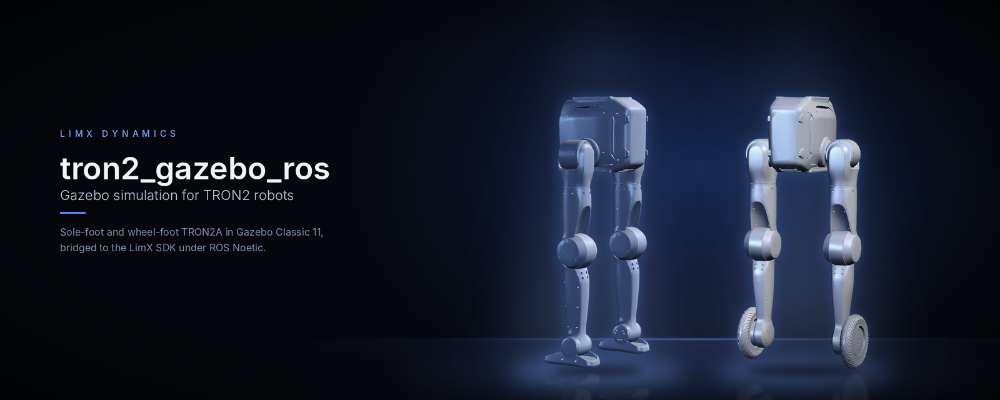

<!--
  SPDX-FileCopyrightText: 2024-2026 LimX Dynamics Technology Co., Ltd.
  SPDX-License-Identifier: Apache-2.0
-->

<p align="center">
  
</p>

<p align="center">
  <b>English</b> | <a href="README_zh-CN.md">中文</a>
</p>

<p align="center">
  <a href="LICENSE"></a>
  
  
  
</p>

# tron2_gazebo_ros

> **Distribution:** the primary open-source copy of this repository is
> hosted at
> [`github.com/limxdynamics/tron2_gazebo_ros`](https://github.com/limxdynamics/tron2_gazebo_ros).
> The internal LimX GitLab is a mirror; open issues, PRs, and security
> reports on the GitHub repository.

Gazebo Classic 11 simulation of the TRON2A biped, sole-foot (`SF_TRON2A`)
and wheel-foot (`WF_TRON2A`), for ROS Noetic. The `Tron2HWSim`
`gazebo_ros_control` plugin exposes the simulated joints and IMU through the
LimX SDK `RobotCmd` / `RobotState` API, so the controller from
[tron2_rl_deploy_ros](https://github.com/limxdynamics/tron2_rl_deploy_ros)
runs against Gazebo exactly as it runs against the robot.

## Highlights

- **Same controller in simulation and on the robot.** Only the launch file
  changes; `tron2_hw` and `tron2_controller` are identical on both paths.
- **SDK bridge, not a ROS-only mock.** Joint commands and state go through
  `limxsdk-sim` (prebuilt for amd64, aarch64, arm32 and Windows).
- **Two TRON2A variants.** `robot_type:=SF_TRON2A` or `robot_type:=WF_TRON2A`.
- **Gamepad or topics.** Drive with a gamepad, or publish `/cmd_vel` and
  `/tron2_controller/set_mode` yourself.
- **Soft start.** The robot is held in the air for 2 s after spawning so the
  controller can settle into its default pose before touching the ground.

## Supported robots

| | Model | Description | Joints / policy actions |
|:-:|---|---|:-:|
|  | `SF_TRON2A` | Biped with sole feet | 10 / 10 |
|  | `WF_TRON2A` | Biped with wheel feet | 10 / 10 |

## How it works

<p align="center">
  
</p>

## Quick start

Ubuntu 20.04 with ROS Noetic and the packages in [section 2](#2-requirements):

```bash
mkdir -p ~/limx_ws/src && cd ~/limx_ws/src
git clone https://github.com/limxdynamics/limxsdk-lowlevel.git
git clone https://github.com/limxdynamics/tron2_gazebo_ros.git
git clone https://github.com/limxdynamics/tron2_rl_deploy_ros.git
git clone https://github.com/limxdynamics/tron2-robot-description.git

cd ~/limx_ws
source /opt/ros/noetic/setup.bash
catkin_make
source devel/setup.bash
roslaunch tron2_hw tron2_hw_sim.launch robot_type:=SF_TRON2A
```

Without a gamepad, add `use_joystick:=false` and start walking from a second
terminal:

```bash
rostopic pub -1 /tron2_controller/set_mode std_msgs/String "data: 'WALK'"
rostopic pub -r 10 /cmd_vel geometry_msgs/Twist "{linear: {x: 0.3}}"
```

---

## 1. Directory layout

The recommended layout is:

```text
~/limx_ws/src
├── CMakeLists.txt                 # catkin top-level entry (usually a symlink)
├── tron2-robot-description        # robot model description package `robot_description` (top level under src)
├── limxsdk-lowlevel               # low-level SDK package (top level under src)
├── tron2_gazebo_ros               # simulation-side package collection (this repository)
│   ├── limxsdk-sim
│   └── tron2_gazebo
└── tron2_rl_deploy_ros            # control / deployment package collection
    ├── onnxruntime_sdk
    ├── robot_common
    ├── tron2_controllers
    └── tron2_hw
```

> Note: catkin discovers packages recursively, so grouping into
> subdirectories does not affect the build as long as each ROS package
> contains a valid `package.xml` and `CMakeLists.txt`.

`tron2_gazebo` depends on `robot_common` from `tron2_rl_deploy_ros`, so this
repository does not build on its own.

## 2. Requirements

- Ubuntu 20.04
- ROS Noetic (`ros-noetic-desktop-full` is recommended)
- Gazebo 11 (default for ROS Noetic)
- Common dependencies (install as needed):

```bash
sudo apt-get update
sudo apt-get install -y \
  ros-noetic-gazebo-ros-pkgs \
  ros-noetic-gazebo-ros-control \
  ros-noetic-ros-control \
  ros-noetic-ros-controllers \
  ros-noetic-controller-manager \
  ros-noetic-joint-state-controller \
  ros-noetic-rqt-controller-manager \
  ros-noetic-robot-state-publisher \
  libeigen3-dev
```

## 3. Workspace setup

Set up an algorithm-development workspace as follows:

- Open a Bash terminal.

- Create a new directory to hold the workspace. For example, create a
  directory called "limx_ws" under your home directory:

  ```
  mkdir -p ~/limx_ws/src
  ```

- Download the motion-control development interface:

  ```
  cd ~/limx_ws/src
  git clone https://github.com/limxdynamics/limxsdk-lowlevel.git
  ```

- Download the Gazebo simulator (this repository):

  ```
  cd ~/limx_ws/src
  git clone https://github.com/limxdynamics/tron2_gazebo_ros.git
  ```

- Download the controller and hardware node (`tron2_hw`,
  `tron2_controllers`, `robot_common`, `onnxruntime_sdk`):

  ```
  cd ~/limx_ws/src
  git clone https://github.com/limxdynamics/tron2_rl_deploy_ros.git
  ```

- Download the TRON2 robot model description:

  ```
  cd ~/limx_ws/src
  git clone https://github.com/limxdynamics/tron2-robot-description.git
  ```

  The launch files load TRON2A models from its `tron2a/` directory. The
  USD files tracked with Git LFS in that repository are not needed for
  Gazebo.

Then, from the workspace root:

```bash
cd ~/limx_ws
source /opt/ros/noetic/setup.bash
catkin_make
```

After a successful build, source the environment:

```bash
source ~/limx_ws/devel/setup.bash
```

## 4. Running the examples

### 4.1 Launch the simulation (full deployment)

```bash
cd ~/limx_ws
source /opt/ros/noetic/setup.bash
source devel/setup.bash
# Bring up a full simulation with the Gazebo scene, hardware node, and controller.
roslaunch tron2_hw tron2_hw_sim.launch robot_type:=SF_TRON2A
```

`robot_type` can be switched to match your configuration
(for example `SF_TRON2A` / `WF_TRON2A`).

### 4.2 Controller only (simulation mode)

If you have already started the Gazebo scene manually, you can bring up
just the hardware node and the controller:

```bash
roslaunch tron2_hw tron2_controller_sim.launch robot_type:=SF_TRON2A
```

### 4.3 Real-hardware deployment

```bash
roslaunch tron2_hw tron2_hw.launch robot_type:=SF_TRON2A robot_ip:=<robot-ip>
```

Useful arguments of `tron2_hw_sim.launch`:

| Argument | Default | Effect |
|---|---|---|
| `robot_type` | `SF_TRON2A` | `SF_TRON2A` or `WF_TRON2A` |
| `use_joystick` | `true` | Start the gamepad teleop node; it exits if no gamepad is connected |
| `air_hold` | `true` | Hold the base in the air after spawning |
| `air_hold_duration` | `2.0` | Seconds to hold the base |
| `spawn_z` | `0.8` | Spawn and hold height in metres |

### 4.4 Gamepad

`joystick_teleop.py` reads the first gamepad through pygame and publishes at
50 Hz:

| Input | Command |
|---|---|
| Left stick up / down | Forward / backward, up to 1.0 m/s |
| Left stick left / right | Sideways, up to 0.5 m/s |
| Right stick left / right | Turn, up to 1.0 rad/s |
| L1 + Y | `WALK` mode |
| L1 + X | `IDLE` mode |

The controller starts in `STAND`. Button indices come from the
`/joystick_buttons` parameter (A 0, B 1, X 2, Y 3, L1 4, R1 5 by default).

## 5. Simulation vs real-hardware logic (important)

Bottom line: **the core control chain is identical**, namely:

- `tron2_hw_node` (`Tron2HW`) -> `RobotHWLoop` -> `controller_manager` -> `tron2_controller`

The two paths differ on the input side:

- Simulation (`tron2_hw_sim.launch`) additionally publishes `/cmd_vel` and
  `/tron2_controller/set_mode` by default.
- Real hardware (`tron2_hw.launch`) primarily uses the channels that the
  SDK subscribes to.

## 6. Configuration file locations

The main control parameters live at:

- `tron2_rl_deploy_ros/tron2_controllers/config/SF_TRON2A/params.yaml`
- `tron2_rl_deploy_ros/tron2_controllers/config/WF_TRON2A/params.yaml`

## 7. Screenshots / GIFs

### 7.1 Simulation deployment

| SF_TRON2A | WF_TRON2A |
| :---: | :---: |
|  |  |

### 7.2 Real-hardware deployment

Suspend the robot before starting the controller during a real-hardware
deployment.


| SF_TRON2A | WF_TRON2A |
| :---: | :---: |
|  |  |

## 8. FAQ

- Package not found at launch:
  - Confirm you have run `source /opt/ros/noetic/setup.bash`.
  - Confirm you have run `source ~/limx_ws/devel/setup.bash`.
- Build errors after moving directories around:
  - Re-run `catkin_make` under `~/limx_ws`.
- Gazebo plugin / controller fails to load:
  - Confirm that `tron2_gazebo`, `tron2_hw`, and `tron2_controllers`
    have all built successfully.
- `xacro` or `cat` cannot find `robot_description/tron2a/<robot_type>/...`:
  - Make sure `robot_description` comes from
    [`tron2-robot-description`](https://github.com/limxdynamics/tron2-robot-description),
    not from the TRON1 `robot-description` repository, then re-source
    `devel/setup.bash`.
- The `joystick_teleop` node exits with "No joystick found!":
  - Connect a gamepad, or launch with `use_joystick:=false` and publish
    `/cmd_vel` and `/tron2_controller/set_mode` yourself (see Quick start).

---

## Verification

The commands below are the same ones CI runs (see
[`.github/workflows/ci.yml`](.github/workflows/ci.yml)); running
them locally before opening a PR saves review round-trips.

```bash
# 1. Workspace build
cd ~/limx_ws
source /opt/ros/noetic/setup.bash
catkin_make
source devel/setup.bash

# 2. package.xml well-formedness
xmllint --noout tron2_gazebo/package.xml limxsdk-sim/package.xml

# 3. Gazebo plugin descriptor
xmllint --noout tron2_gazebo/tron2_hw_sim_plugins.xml

# 4. Committed-binary deny-list (outside limxsdk-sim/lib/)
git ls-files | grep -iE '\.(onnx|pt|pth|ckpt|so|dll|dylib|lib|whl|bag|mcap)$' | \
    grep -v '^limxsdk-sim/lib/'

# 5. Bundled SDK binary checksums (⚠ TO CONFIRM in THIRD_PARTY_NOTICES.md §2)
sha256sum \
  limxsdk-sim/lib/aarch64/liblimxsdk_sim.so \
  limxsdk-sim/lib/amd64/liblimxsdk_sim.so \
  limxsdk-sim/lib/arm32/liblimxsdk_sim.so \
  limxsdk-sim/lib/win/limxsdk_sim.dll \
  limxsdk-sim/lib/win/limxsdk_sim.lib

# 6. Private-IP scan (allowlist: apibase.h placeholder)
grep -RnE '\b(10|172\.(1[6-9]|2[0-9]|3[01])|192\.168)\.[0-9]+\.[0-9]+\b' \
     tron2_gazebo limxsdk-sim | \
     grep -v 'limxsdk-sim/include/limxsdk/apibase.h' | \
     grep -v '127\.0\.0\.1'
```

This pass checked the launch files, plugin, teleop script and their
dependencies against `tron2_rl_deploy_ros` and `tron2-robot-description`. It
did not build the workspace or run Gazebo.

---

## Cite & support

If you use this simulation stack in academic or public work, please
cite the repository:

```
@misc{limx_tron2_gazebo_ros_2026,
  title  = {TRON2 Gazebo / ROS simulation},
  author = {LimX Dynamics},
  year   = {2026},
  howpublished = {\url{https://github.com/limxdynamics/tron2_gazebo_ros}}
}
```

- **Bug reports / feature requests:**
  [GitHub Issues](https://github.com/limxdynamics/tron2_gazebo_ros/issues).
- **Questions / integration help:** see the [FAQ](#8-faq) first, then
  open a [GitHub issue](https://github.com/limxdynamics/tron2_gazebo_ros/issues).
- **Security reports:** email `contact@limxdynamics.com`; see
  [`SECURITY.md`](SECURITY.md).
- **Company / commercial contact:** <https://www.limxdynamics.com>.

---

## License & attribution

This repository is licensed under the **Apache License, Version 2.0**
(see [`LICENSE`](LICENSE)). Both ROS packages declare
`<license>Apache-2.0</license>` in their `package.xml`, consistent with
the top-level LICENSE.

Companion documents in this repository:

- [`NOTICE`](NOTICE) — required attribution notice.
- [`THIRD_PARTY_NOTICES.md`](THIRD_PARTY_NOTICES.md) — bundled SDK
  binaries (§2), Gazebo / ROS runtime deps (§4), and documentation
  media (§5). Rows still marked `⚠ TO CONFIRM` continue to block the
  first public tag.
- [`SECURITY.md`](SECURITY.md) — how to report a vulnerability;
  private-IP handling policy for `limxsdk-sim/include/limxsdk/apibase.h`.
- [`CONTRIBUTING.md`](CONTRIBUTING.md) — `catkin_make` workflow,
  no-CAD / no-binary policy, DCO sign-off.
- [`CHANGELOG.md`](CHANGELOG.md) — release notes and the remaining
  "Pending owner sign-off" list.

> **Note.** Any link that previously pointed at
> `../tron2-rl-deploy-ros/LICENSE` is **not** a licence grant for
> *this* repository — the section above, `NOTICE`, and
> `THIRD_PARTY_NOTICES.md` §1 are the authoritative status. Both
> `tron2_gazebo/package.xml` and `limxsdk-sim/package.xml` declare
> `Apache-2.0` (resolved 2026-07-14, see `THIRD_PARTY_NOTICES.md` §1).

## Scope

**Included** in this repository:

- `tron2_gazebo` — a Gazebo Classic 11 `gazebo_ros_control` plugin
  (`Tron2HWSim`) that exposes a hybrid joint effort interface and
  bridges to the TRON2 SDK RobotCmd / RobotState API. See
  `tron2_gazebo/src/Tron2HWSim.cpp`.
- `limxsdk-sim` — simulation-side C++ SDK. Public headers under
  `limxsdk-sim/include/limxsdk/` plus pre-built binaries under
  `limxsdk-sim/lib/{aarch64,amd64,arm32,win}/`.
- Example worlds, launch files, and controller configs under
  `tron2_gazebo/{worlds,launch,config}/`.
- Reference GIFs and one deployment photo under `doc/`.

**Not included** — by design:

- **No vendor clearance** yet on the four bundled SDK binaries
  (`limxsdk-sim/lib/*/liblimxsdk_sim.so`,
  `limxsdk-sim/lib/win/limxsdk_sim.{dll,lib}`). Provenance,
  SHA-256, and re-distribution license are pending sign-off
  (`THIRD_PARTY_NOTICES.md` §2).
- No control policies (`.onnx`, `.pt`, `.pth`, `.ckpt`).
- No factory calibration values or per-serial calibration files.
- No firmware or bootloader artifacts.
- No motion / trajectory data (rosbags, MCAP, HDF5 captures).
- **No production-network robot IP addresses.** Command examples ship
  `<robot-ip>` as a placeholder token — substitute your robot's IP
  before running. The header
  `limxsdk-sim/include/limxsdk/apibase.h` retains a documentation
  example literal `10.192.1.2` describing typical real-hardware
  usage; this is a documentation value only and is not the address
  of any LimX production network. See [`SECURITY.md`](SECURITY.md)
  for the private-IP handling policy.
- No customer-specific or site-specific configuration.

For the deployment stack, model weights, and the real-robot SDK,
see the sibling repositories
[`tron2_rl_deploy_ros`](https://github.com/limxdynamics/tron2_rl_deploy_ros),
[`limxsdk-lowlevel`](https://github.com/limxdynamics/limxsdk-lowlevel) and
[`tron2-robot-description`](https://github.com/limxdynamics/tron2-robot-description).
