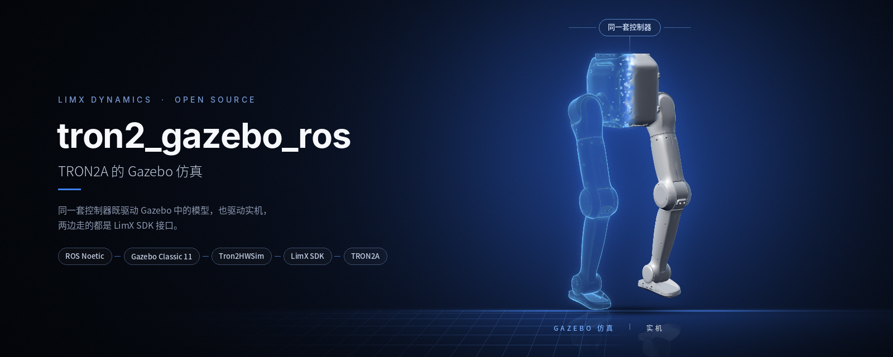
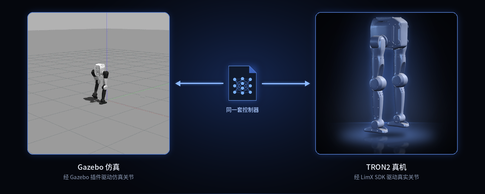
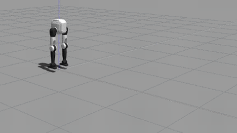
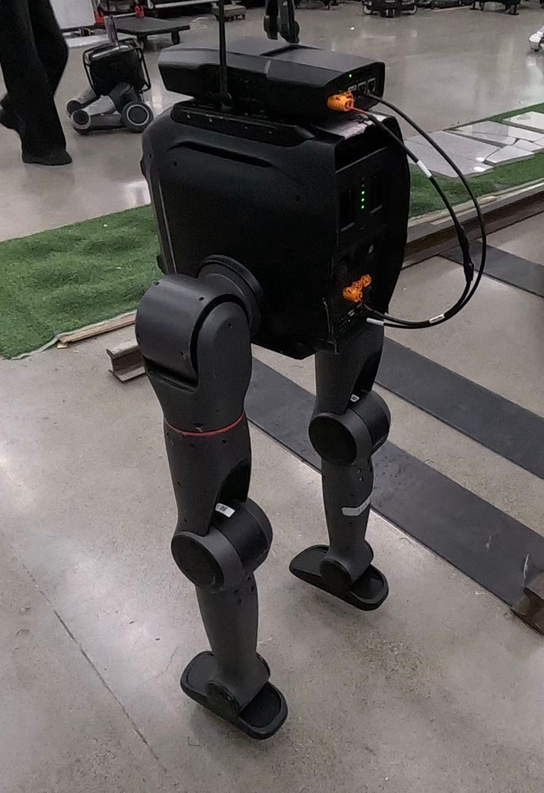
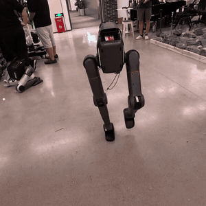

<!--
  SPDX-FileCopyrightText: 2024-2026 LimX Dynamics Technology Co., Ltd.
  SPDX-License-Identifier: Apache-2.0
-->

<p align="center">
  
</p>

<p align="center">
  <a href="README.md">English</a> | <b>中文</b>
</p>

<p align="center">
  <a href="LICENSE"></a>
  
  
  
</p>

# tron2_gazebo_ros

> **分发说明：** 本仓库的开源主副本托管于
> [`github.com/limxdynamics/tron2_gazebo_ros`](https://github.com/limxdynamics/tron2_gazebo_ros)。
> LimX 内部 GitLab 仅为镜像；Issue、PR 和安全报告请提交到 GitHub 仓库。

TRON2A 双足机器人在 ROS Noetic 下的 Gazebo Classic 11 仿真，支持足底（`SF_TRON2A`）和轮足（`WF_TRON2A`）。`Tron2HWSim` 这个 `gazebo_ros_control` 插件通过 LimX SDK 的 `RobotCmd` / `RobotState` 接口暴露仿真关节和 IMU，因此 [tron2_rl_deploy_ros](https://github.com/limxdynamics/tron2_rl_deploy_ros) 中的控制器在 Gazebo 里的运行方式与在真机上完全相同。

## 亮点

- **仿真和真机用同一套控制器。** 只换 launch 文件，`tron2_hw` 和 `tron2_controller` 两条路径完全一致。
- **走 SDK 桥接，不是纯 ROS 模拟。** 关节指令和状态经由 `limxsdk-sim`（提供 amd64、aarch64、arm32 和 Windows 预编译库）。
- **两种 TRON2A。** `robot_type:=SF_TRON2A` 或 `robot_type:=WF_TRON2A`。
- **手柄或话题控制。** 可以用手柄，也可以自己发布 `/cmd_vel` 和 `/tron2_controller/set_mode`。
- **平稳起步。** 机器人生成后先悬空 2 秒，让控制器先收敛到默认姿态再落地。

## 支持的机型

| | 机型 | 说明 | 关节数 / 策略动作数 |
|:-:|---|---|:-:|
|  | `SF_TRON2A` | 足底双足 | 10 / 10 |
|  | `WF_TRON2A` | 轮足双足 | 10 / 10 |

## 工作原理

<p align="center">
  
</p>

## 快速开始

Ubuntu 20.04，已安装 ROS Noetic 和[第 2 节](#2-环境要求)中的依赖：

```bash
mkdir -p ~/limx_ws/src && cd ~/limx_ws/src
git clone https://github.com/limxdynamics/limxsdk-lowlevel.git
git clone https://github.com/limxdynamics/tron2_gazebo_ros.git
git clone https://github.com/limxdynamics/tron2_rl_deploy_ros.git
git clone https://github.com/limxdynamics/tron2-robot-description.git

cd ~/limx_ws
source /opt/ros/noetic/setup.bash
catkin_make
source devel/setup.bash
roslaunch tron2_hw tron2_hw_sim.launch robot_type:=SF_TRON2A
```

没有手柄时加上 `use_joystick:=false`，在另一个终端里切换到行走：

```bash
rostopic pub -1 /tron2_controller/set_mode std_msgs/String "data: 'WALK'"
rostopic pub -r 10 /cmd_vel geometry_msgs/Twist "{linear: {x: 0.3}}"
```

---

## 1. 目录结构

当前建议结构如下：

```text
~/limx_ws/src
├── CMakeLists.txt                 # catkin 顶层入口（通常为软链接）
├── tron2-robot-description        # 机器人模型描述包 `robot_description`（独立放在 src 一级）
├── limxsdk-lowlevel               # 低层 SDK 包（独立放在 src 一级）
├── tron2_gazebo_ros               # 仿真相关包集合（本仓库）
│   ├── limxsdk-sim
│   └── tron2_gazebo
└── tron2_rl_deploy_ros            # 控制/部署相关包集合
    ├── onnxruntime_sdk
    ├── robot_common
    ├── tron2_controllers
    └── tron2_hw
```

> 注意：catkin 支持递归发现包，因此子目录分组不会影响编译，只要每个 ROS 包内有合法 `package.xml` 与 `CMakeLists.txt`。

`tron2_gazebo` 依赖 `tron2_rl_deploy_ros` 中的 `robot_common`，所以本仓库不能单独编译。

## 2. 环境要求

- Ubuntu 20.04
- ROS Noetic（建议 `ros-noetic-desktop-full`）
- Gazebo 11（ROS Noetic 默认）
- 常见依赖（按需补齐）：

```bash
sudo apt-get update
sudo apt-get install -y \
  ros-noetic-gazebo-ros-pkgs \
  ros-noetic-gazebo-ros-control \
  ros-noetic-ros-control \
  ros-noetic-ros-controllers \
  ros-noetic-controller-manager \
  ros-noetic-joint-state-controller \
  ros-noetic-rqt-controller-manager \
  ros-noetic-robot-state-publisher \
  libeigen3-dev
```

## 3. 创建工作空间

可以按照以下步骤，创建一个算法开发工作空间：

- 打开一个 Bash 终端。

- 创建一个新目录来存放工作空间。例如，可以在用户的主目录下创建一个名为“limx_ws”的目录：

  ```
  mkdir -p ~/limx_ws/src
  ```

- 下载运动控制开发接口：

  ```
  cd ~/limx_ws/src
  git clone https://github.com/limxdynamics/limxsdk-lowlevel.git
  ```

- 下载 Gazebo 仿真器（本仓库）：

  ```
  cd ~/limx_ws/src
  git clone https://github.com/limxdynamics/tron2_gazebo_ros.git
  ```

- 下载控制器和硬件节点（`tron2_hw`、`tron2_controllers`、`robot_common`、`onnxruntime_sdk`）：

  ```
  cd ~/limx_ws/src
  git clone https://github.com/limxdynamics/tron2_rl_deploy_ros.git
  ```

- 下载 TRON2 机器人模型描述文件

  ```
  cd ~/limx_ws/src
  git clone https://github.com/limxdynamics/tron2-robot-description.git
  ```

  launch 文件从其中的 `tron2a/` 目录加载 TRON2A 模型。该仓库中用 Git LFS 管理的 USD 文件 Gazebo 用不到。

在工作区根目录执行：

```bash
cd ~/limx_ws
source /opt/ros/noetic/setup.bash
catkin_make
```

编译成功后建议加载环境：

```bash
source ~/limx_ws/devel/setup.bash
```

## 4. 运行示例

### 4.1 启动仿真（完整部署）

```bash
cd ~/limx_ws
source /opt/ros/noetic/setup.bash
source devel/setup.bash
# 启动包含 Gazebo 场景、硬件节点和控制器的完整仿真
roslaunch tron2_hw tron2_hw_sim.launch robot_type:=SF_TRON2A
```

`robot_type` 可按你的配置切换（例如 `SF_TRON2A` / `WF_TRON2A`）。


### 4.2 仅启动控制器（仿真模式）

如果你已经手动启动了 Gazebo 场景，可以只启动硬件节点和控制器：

```bash
roslaunch tron2_hw tron2_controller_sim.launch robot_type:=SF_TRON2A
```

### 4.3 实物部署

```bash
roslaunch tron2_hw tron2_hw.launch robot_type:=SF_TRON2A robot_ip:=<robot-ip>
```

`tron2_hw_sim.launch` 常用参数：

| 参数 | 默认值 | 作用 |
|---|---|---|
| `robot_type` | `SF_TRON2A` | `SF_TRON2A` 或 `WF_TRON2A` |
| `use_joystick` | `true` | 启动手柄遥控节点；没有接手柄时该节点会退出 |
| `air_hold` | `true` | 生成后把机身悬在空中 |
| `air_hold_duration` | `2.0` | 悬空时长（秒） |
| `spawn_z` | `0.8` | 生成及悬空高度（米） |

### 4.4 手柄

`joystick_teleop.py` 通过 pygame 读取第一个手柄，以 50 Hz 发布：

| 输入 | 指令 |
|---|---|
| 左摇杆上 / 下 | 前进 / 后退，最大 1.0 m/s |
| 左摇杆左 / 右 | 横移，最大 0.5 m/s |
| 右摇杆左 / 右 | 转向，最大 1.0 rad/s |
| L1 + Y | 切换到 `WALK` |
| L1 + X | 切换到 `IDLE` |

控制器启动时处于 `STAND`。按键编号来自参数 `/joystick_buttons`（默认 A 0、B 1、X 2、Y 3、L1 4、R1 5）。

## 5. 仿真与实机逻辑说明（重要）

结论：**核心控制链路逻辑一致**，都是：

- `tron2_hw_node`（`Tron2HW`） -> `RobotHWLoop` -> `controller_manager` -> `tron2_controller`

但两者有输入侧差异：

- 仿真（`tron2_hw_sim.launch`）默认还会发 `/cmd_vel` 和 `/tron2_controller/set_mode`。
- 实机（`tron2_hw.launch`）主要走 SDK 订阅的通道。

## 6. 控制参数位置

主要控制参数位于：

- `tron2_rl_deploy_ros/tron2_controllers/config/SF_TRON2A/params.yaml`
- `tron2_rl_deploy_ros/tron2_controllers/config/WF_TRON2A/params.yaml`

## 7. 效果展示

### 7.1 仿真部署

| SF_TRON2A | WF_TRON2A |
| :---: | :---: |
|  |  |

### 7.2 实机部署

实机部署时请悬挂启动控制器



| SF_TRON2A | WF_TRON2A |
| :---: | :---: |
|  |  |

## 8. 常见问题

- 启动时报找不到包：
  - 确认已执行 `source /opt/ros/noetic/setup.bash`
  - 确认已执行 `source ~/limx_ws/devel/setup.bash`
- 修改目录后编译异常：
  - 在 `~/limx_ws` 下重新执行 `catkin_make`
- Gazebo 插件/控制器加载失败：
  - 先确认 `tron2_gazebo`、`tron2_hw`、`tron2_controllers`均已成功编译
- `xacro` 或 `cat` 找不到 `robot_description/tron2a/<robot_type>/...`：
  - 确认 `robot_description` 来自 [`tron2-robot-description`](https://github.com/limxdynamics/tron2-robot-description)，而不是 TRON1 的 `robot-description` 仓库，然后重新 source `devel/setup.bash`
- `joystick_teleop` 节点报 "No joystick found!" 后退出：
  - 接上手柄，或用 `use_joystick:=false` 启动，自行发布 `/cmd_vel` 和 `/tron2_controller/set_mode`（见快速开始）

---

## 验证

下列命令与 CI 中执行的一致（见
[`.github/workflows/ci.yml`](.github/workflows/ci.yml)）；在提交 PR
前先在本地跑一遍，可以减少来回评审。

```bash
# 1. 工作区编译
cd ~/limx_ws
source /opt/ros/noetic/setup.bash
catkin_make
source devel/setup.bash

# 2. package.xml 合法性
xmllint --noout tron2_gazebo/package.xml limxsdk-sim/package.xml

# 3. Gazebo 插件描述文件
xmllint --noout tron2_gazebo/tron2_hw_sim_plugins.xml

# 4. 已提交二进制的黑名单检查（`limxsdk-sim/lib/` 之外）
git ls-files | grep -iE '\.(onnx|pt|pth|ckpt|so|dll|dylib|lib|whl|bag|mcap)$' | \
    grep -v '^limxsdk-sim/lib/'

# 5. 内置 SDK 二进制校验和（THIRD_PARTY_NOTICES.md §2 中仍为 ⚠ TO CONFIRM）
sha256sum \
  limxsdk-sim/lib/aarch64/liblimxsdk_sim.so \
  limxsdk-sim/lib/amd64/liblimxsdk_sim.so \
  limxsdk-sim/lib/arm32/liblimxsdk_sim.so \
  limxsdk-sim/lib/win/limxsdk_sim.dll \
  limxsdk-sim/lib/win/limxsdk_sim.lib

# 6. 私网 IP 扫描（allowlist：apibase.h 占位符）
grep -RnE '\b(10|172\.(1[6-9]|2[0-9]|3[01])|192\.168)\.[0-9]+\.[0-9]+\b' \
     tron2_gazebo limxsdk-sim | \
     grep -v 'limxsdk-sim/include/limxsdk/apibase.h' | \
     grep -v '127\.0\.0\.1'
```

本次整改对照 `tron2_rl_deploy_ros` 和 `tron2-robot-description` 检查了 launch 文件、插件、手柄脚本及其依赖，没有编译工作区，也没有运行 Gazebo。

---

## 引用与支持

如果你在学术工作或公开发表中使用了本仿真栈，请引用本仓库：

```
@misc{limx_tron2_gazebo_ros_2026,
  title  = {TRON2 Gazebo / ROS simulation},
  author = {LimX Dynamics},
  year   = {2026},
  howpublished = {\url{https://github.com/limxdynamics/tron2_gazebo_ros}}
}
```

- **Bug 上报 / 功能建议：**
  [GitHub Issues](https://github.com/limxdynamics/tron2_gazebo_ros/issues)。
- **使用问题 / 集成协助：** 先查看[常见问题](#8-常见问题)，再提交
  [GitHub Issue](https://github.com/limxdynamics/tron2_gazebo_ros/issues)。
- **安全上报：** 发送邮件至 `contact@limxdynamics.com`；详见
  [`SECURITY.md`](SECURITY.md)。
- **公司 / 商务联系：** <https://www.limxdynamics.com>。

---

## 许可与归属

本仓库基于 **Apache License, Version 2.0** 授权（详见
[`LICENSE`](LICENSE)）。两个 ROS 包在各自的 `package.xml` 中均声明
`<license>Apache-2.0</license>`，与顶层 LICENSE 保持一致。

仓库中的配套文档：

- [`NOTICE`](NOTICE) — 必需的归属声明。
- [`THIRD_PARTY_NOTICES.md`](THIRD_PARTY_NOTICES.md) — 内置 SDK
  二进制（§2）、Gazebo / ROS 运行时依赖（§4）以及文档媒体（§5）。
  仍标注 `⚠ TO CONFIRM` 的条目会继续阻塞首个公开发布 tag。
- [`SECURITY.md`](SECURITY.md) — 漏洞上报流程；针对
  `limxsdk-sim/include/limxsdk/apibase.h` 中私网 IP 的处理策略。
- [`CONTRIBUTING.md`](CONTRIBUTING.md) — `catkin_make` 工作流、
  无 CAD / 无二进制策略、DCO 签署要求。
- [`CHANGELOG.md`](CHANGELOG.md) — 版本说明及剩余的
  "Pending owner sign-off" 清单。

> **说明：** 任何此前指向
> `../tron2-rl-deploy-ros/LICENSE` 的链接都**不是**对*本*仓库的许可授予
> ——上述章节、`NOTICE` 及 `THIRD_PARTY_NOTICES.md` §1 才是权威状态。
> `tron2_gazebo/package.xml` 和 `limxsdk-sim/package.xml` 均已声明
> `Apache-2.0`（2026-07-14 确认，见 `THIRD_PARTY_NOTICES.md` §1）。


## 适用范围

本仓库**包含**以下内容：

- `tron2_gazebo` — 基于 Gazebo Classic 11 的 `gazebo_ros_control` 插件
  (`Tron2HWSim`)，提供混合关节力矩接口并桥接到 TRON2 SDK 的
  RobotCmd / RobotState API。见 `tron2_gazebo/src/Tron2HWSim.cpp`。
- `limxsdk-sim` — 仿真侧 C++ SDK。公共头文件位于
  `limxsdk-sim/include/limxsdk/`，预编译二进制位于
  `limxsdk-sim/lib/{aarch64,amd64,arm32,win}/`。
- 示例世界文件、launch 文件、控制器配置，位于
  `tron2_gazebo/{worlds,launch,config}/`。
- 参考 GIF 与一张实机部署照片，位于 `doc/`。

本仓库**有意不包含**：

- **尚未取得供应商放行**的四个内置 SDK 二进制
  (`limxsdk-sim/lib/*/liblimxsdk_sim.so`、
  `limxsdk-sim/lib/win/limxsdk_sim.{dll,lib}`)。来源、
  SHA-256 与再分发许可仍待签署确认
  (`THIRD_PARTY_NOTICES.md` §2)。
- 任何控制策略权重（`.onnx`、`.pt`、`.pth`、`.ckpt`）。
- 工厂标定数据或按机号定制的标定文件。
- 固件或 bootloader 产物。
- 运动 / 轨迹数据（rosbag、MCAP、HDF5 采集数据）。
- **不包含任何生产环境的机器人 IP 地址。** 命令示例统一使用
  `<robot-ip>` 作为占位符 token，运行前请替换为你实际的机器人 IP。
  头文件 `limxsdk-sim/include/limxsdk/apibase.h` 中保留字面量
  `10.192.1.2` 作为描述典型真机使用场景的文档示例；该值仅为
  文档示例，并非任何 LimX 生产网络的地址。私网 IP 处理策略详见
  [`SECURITY.md`](SECURITY.md)。
- 客户特定或场地特定的配置。

部署栈、模型权重与实机 SDK 请参考兄弟仓库
[`tron2_rl_deploy_ros`](https://github.com/limxdynamics/tron2_rl_deploy_ros)、
[`limxsdk-lowlevel`](https://github.com/limxdynamics/limxsdk-lowlevel) 和
[`tron2-robot-description`](https://github.com/limxdynamics/tron2-robot-description)。
